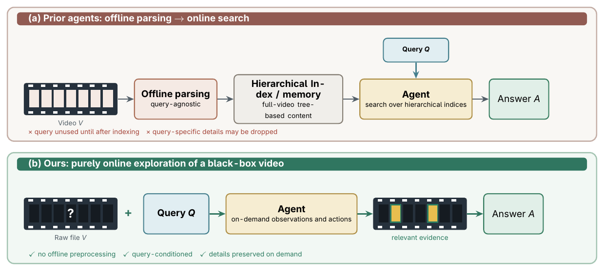
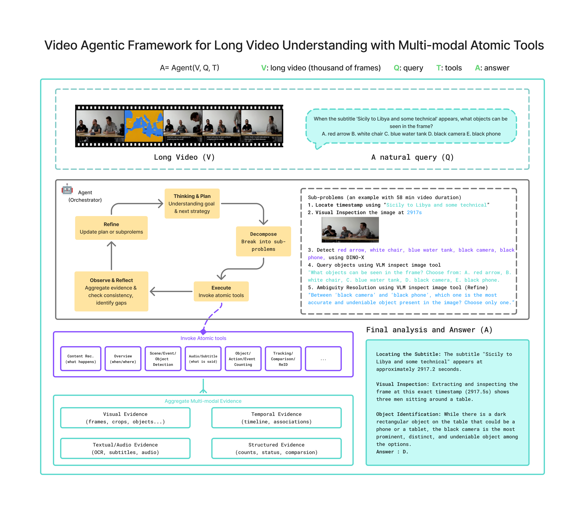

# VideoXAgent: Online Video Agent Harness for Long Video Understanding

**Baidu Inc.**

Sen Yang\*, Boqiang Duan\*, Jing Yang<sup>†</sup>, Weihao Bo<sup>†</sup>,
Jie Liu<sup>†</sup>, Boyuan Tong<sup>†</sup>, Ze Feng<sup>†</sup>, Wenkang Zhang<sup>†</sup>,
Jingdong Wang, Hua Wu

\* Equal contributions. <sup>†</sup> Work done during internships at Baidu.

[[`Paper`](https://arxiv.org/pdf/2609.12818)] [[`Project Page`](https://go-agent-x.github.io/video_agent_harness/)] [[`BibTeX`](#citing-videoxagent)]

**VideoXAgent** is a purely online agent harness for long video understanding.
Starting from a video and a user query, it plans tasks, invokes specialist tools on
demand, and combines multimodal evidence to answer the query.

This repository provides a DeepAgents-based agent and specialist MCP tools for media
extraction, subtitle and audio processing, visual understanding, object detection
and tracking, and temporal retrieval, together with a web demo and evaluation scripts.

## Method



**Online exploration.** VideoXAgent starts from the raw video and the user query,
then acquires relevant evidence on demand without building an offline video index.



**System architecture.** The orchestrator plans and decomposes the query, invokes
specialist tools, aggregates visual, temporal, audio, and textual evidence, and
refines its plan to resolve ambiguities before producing an answer.
Both figures are from the [project page](https://go-agent-x.github.io/video_agent_harness/#method).

## Experimental Results

The following results are reported in the
[paper](https://arxiv.org/pdf/2609.12818) and summarized on the
[project page](https://go-agent-x.github.io/video_agent_harness/#exp).

### Long-video benchmarks

These experiments use **Claude-Opus-4.6** as the orchestrator and
**Gemini-3.1-Pro-preview** for VLM tools (paper Table 1).
Video-MME-Long and LongVideoBench-Long include subtitles. LVBench uses visual
frames only, with subtitle, ASR, and other audio tools disabled.

| Benchmark | Accuracy (%) | Average VLM frames | Reported agent context (tokens) |
| :--- | ---: | ---: | ---: |
| Video-MME-Long | **85.1** | 52.0 | 51k |
| LongVideoBench-Long | **78.1** | 116.7 | 55.3k |
| LVBench (vision only) | **76.5** | 60.8 | 55k |

Frame counts are average inputs to VLM tools per example. Agent context measures
the maximum prompt-context size reached during an agent run, rather than
cumulative token consumption.

### MINERVA

These experiments use **Qwen3.6-35B-A3B** for VLM tools and the publicly released
MINERVA set of **1,357 questions** (paper Table 2).

| Orchestrator | Accuracy (%) | Context tokens: mean (min–max) | Mean agent steps |
| :--- | ---: | ---: | ---: |
| GLM-5.2 (text only) | **65.4** | 33.7k (17.7k–189.9k) | 35.6 |
| Claude-Opus-4.6 | **65.7** | 37.1k (25.0k–97.6k) | 27.5 |

Context statistics are reported per example; agent steps count iterations of the
tool loop. See the paper for complete comparisons, evaluation settings, and ablations.

## Tool Organization

The 43 MCP services are grouped by capability under `tools/`:

```text
tools/
├── media/       # Video input, extraction, cropping, and image composition
├── vision/      # Inspection, detection, segmentation, tracking, recognition
├── audio/       # Transcription, diarization, audio events, music
├── text/        # OCR and subtitles
├── motion/      # Optical flow, frame differences, camera/object motion
├── spatial/     # Geometry, spatial relations, and depth
├── temporal/    # Scene changes, grounding, and moment retrieval
└── composite/   # Scene understanding and multimodal tools
```

See the [tool directory guide](tools/README.md) for the service list and
[catalog](tools/catalog.json) for entrypoints and dependency profiles. Shared
utilities, schemas, models, and data remain at the repository root.

## Getting Started

Follow these five steps to install VideoXAgent, prepare models and data, run a
benchmark, and inspect the results. The commands below use **Video-MME-Long** as
one complete example. Run them from the repository root after cloning.

### 1. Install

Prepare Python 3.11, FFmpeg, Git, `curl`, `unzip`, and `tar`. Then clone the repository
and install the dependency profiles, including the dependencies for dataset export:

```bash
git clone https://github.com/BoqiangDuan/VideoXAgent.git
cd VideoXAgent

# CPU dependency installation
bash scripts/install_profiles.sh all --torch-backend cpu --paddle-backend cpu --evaluation
```

The installer prepares `.venvs/`, updates `.mcp.profiles.json`, and sets runtime
device preferences for the selected profiles to match the installation backends.
See the [installation guide](install.md) for CUDA installation and other options.

### 2. Download Model Weights

Download the weights used by your enabled MCP tools. The downloader selects each
component's vision, audio, or OCR environment automatically:

```bash
bash scripts/download_models.sh --venv-root .venvs all
```

Weights are stored in `models/` or the relevant model cache. Prepare them before
inference: the batch launcher enables Hugging Face offline mode. LLM/VLM API access
is configured separately in step 4. See [model setup](MODEL_SETUP.md) for selective
downloads, optional diarization/gaze weights, and model access requirements.

### 3. Prepare Benchmark Data

Obtain the benchmark annotations and videos, and arrange the local archives as
described in the [data preparation guide](scripts/data_process/README.md). The
preparation script extracts local inputs and exports JSONL; it does not download
the datasets.

```bash
bash scripts/data_process/prepare_all_data.sh \
  --data-src /absolute/path/to/prepared-datasets videomme
```

For this example, the long-video split is written to
`data/videomme/test/long_duration_data.jsonl`. Other supported dataset arguments
include `longvideobench`, `lvbench`, `minerva`, and `videomme_v2`. Re-export after
moving the data to another machine, because generated prompts contain absolute
video paths.

### 4. Select a Configuration and Run the Benchmark

Choose a configuration for the dataset you prepared:

| Benchmark | Configuration |
| --- | --- |
| Video-MME-Long | [videomme_long_claude.yaml](exp_configs/examples/videomme_long_claude.yaml) |
| LongVideoBench-Long | [longvideobench_long_claude.yaml](exp_configs/examples/longvideobench_long_claude.yaml) |
| LVBench | [lvbench_gemini.yaml](exp_configs/examples/lvbench_gemini.yaml) |
| MINERVA | [minerva_gemini.yaml](exp_configs/examples/minerva_gemini.yaml) |

Create the local credential file if it does not exist:

```bash
test -f key.yaml || cp key.yaml.example key.yaml
```

Before launching, fill in `LLM_API_KEY` and `VLM_API_KEY` in `key.yaml`, then update
the selected YAML's model provider, model ID, endpoint, `vlm_model_name`, and
`VLM_API_URL`. Check `data_files`, `system_prompt_file`, and `exp_name` as well.

Review `.mcp.profiles.json`, selected by `mcp_json_file` in the example YAMLs:

- Keep only services with available server files, installed environments, and
  prepared weights.
- Remove stale per-server VLM model, endpoint, and key overrides, or make them
  consistent with the selected experiment; these values take precedence over the
  YAML and `key.yaml`.
- Match tool device settings to your hardware. The installer sets preferences for
  selected backends. To change them separately, run
  `.venvs/base/bin/python scripts/configure_mcp_profiles.py --device cpu --ocr-device cpu`;
  see the
  [runtime configuration notes](install.md#2-use-the-generated-mcp-configuration).

Then launch the selected experiment:

```bash
bash auto_deepagents.sh exp_configs/examples/videomme_long_claude.yaml --log
```

Examples default to **one question and one worker**. After that run succeeds,
increase `max_samples` and `workers` in the YAML for the intended evaluation split.
These examples were adapted from sampled experiments and are not exact paper
reproduction configurations; see the [configuration guide](exp_configs/README.md)
for model/tool differences, subset selection, and resume behavior.

For the Video-MME example, outputs are saved to:

- `conversations/all_data_path_videomme_long_claude_example.json`: session index.
- `conversations/transcripts/`: execution trajectories in JSONL format.
- `logs/deepagents_*.log`: console logs when `--log` is enabled.

The session index filename follows `exp_name`; use the matching file in step 5.
For interactive use, see the [web demo guide](demo/README.md).

### 5. Evaluate Accuracy and Visualize Trajectories

Match the saved sessions against the prepared annotations and extract their final
answers:

```bash
.venvs/base/bin/python html_show/add_gt_answer.py \
  conversations/all_data_path_videomme_long_claude_example.json
```

This command updates the selected session index with `gt_answer`, `model_answer`,
and `is_correct`, and prints accuracy as **correct / (correct + incorrect)**.
Sessions without a Boolean correctness result are excluded. Check missing answers,
failed runs, and dataset coverage before reporting benchmark accuracy. The scorer
supports Video-MME, LongVideoBench, LVBench, and MINERVA; Video-MME-v2 has a separate
evaluator in `scripts/eval_videomme_v2.py`.

Generate the dashboard and start the trajectory viewer using the same result file:

```bash
PYTHON_BIN="$PWD/.venvs/base/bin/python" \
  bash html_show/start_session_server_tool.sh \
  --data conversations/all_data_path_videomme_long_claude_example.json \
  --tag videomme_long_claude_example
```

Open [the generated dashboard](http://127.0.0.1:8923/html_show/tool_workflow_videomme_long_claude_example.html)
or the `Tool Workflow` URL printed by the launcher. **Evaluation** shows answers,
execution trajectories, and tool images; **Tool Usage** shows tool-call statistics.
The viewer binds to `127.0.0.1` by default. For a Linux server, use SSH port
forwarding, or configure authenticated remote access as described in the
[visualization guide](html_show/USAGE.md#access-control).
Dashboard percentages can differ from the scoring CLI when records are unscored,
because they use different denominators.

Rerun the launcher after new inference or scoring to refresh the page. Keep the
session index, referenced JSONL trajectories, and generated media together. See
the [visualization guide](html_show/USAGE.md) for custom ports and relocated results.

## Documentation

- [Installation guide](install.md)
- [Experiment configurations and batch launch](exp_configs/README.md)
- [Benchmark data preparation](scripts/data_process/README.md)
- [Trajectory visualization](html_show/USAGE.md)
- [Dependency profiles](requirements/profiles/README.md)
- [Model downloads and configuration](MODEL_SETUP.md)
- [Shared MCP framework](_base/README.md)
- [MCP tool directories](tools/README.md)
- [Tool definitions](_tool_defs/README.md)

## Development

```bash
bash scripts/install_profiles.sh base --dev
.venvs/base/bin/python -m pytest \
  _base/tests/test_dependency_profiles.py _base/tests/test_profile_agent_runtime.py
```

Project dependency ranges and optional extras are maintained in `pyproject.toml`;
profile manifests under `requirements/profiles/` define the isolated environments.
Tool-local `requirements.txt` files are compatibility references, not additional
installation steps.

## Citing VideoXAgent

If you use VideoXAgent in your research, please use the following BibTeX entry.

```bibtex
@article{yang2026videoxagent,
  title   = {Online Video Agent Harness for Long Video Understanding},
  author  = {Yang, Sen and Duan, Boqiang and Yang, Jing and Bo, Weihao and Liu, Jie and Tong, Boyuan and Feng, Ze and Zhang, Wenkang and Wang, Jingdong and Wu, Hua},
  journal = {arXiv preprint arXiv:2609.12818},
  url     = {https://arxiv.org/abs/2609.12818},
  year    = {2026}
}
```
